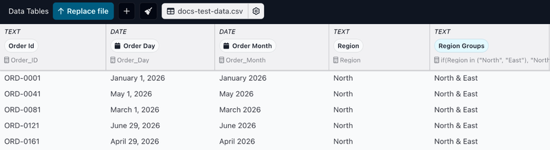
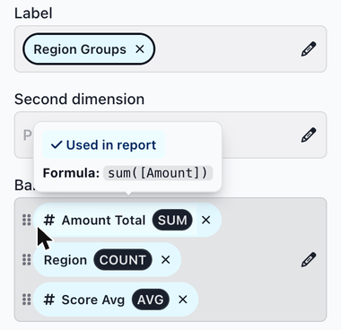

# Ingredients

Ingredients are the dimensions and measures that slices use. A **dimension** describes or groups your data, such as Region, Product or Order Day. A **measure** is a calculation over a group of rows, such as total sales, average score or the number of customers. When you configure a slice, you pick the dimensions and measures it shows.

### Dimensions

When you add a data table, Juicebox creates one dimension for each column. You can add more dimensions built from columns with formulas, for example a dimension that groups four regions into two larger areas. See [Adding new ingredients](adding-new-ingredients.md).

To see a data table's dimensions, click the data table's name in the **Data Tables** bar at the bottom of the screen. This opens the [data preview](../../data-sources/the-data-preview.md), which shows every dimension, including ones built with formulas. The top of each dimension shows its data type, its pill, and the column or formula it is based on.

<figure><figcaption></figcaption></figure>

### Measures

A measure's formula uses an aggregation function, such as `sum()`, `avg()`, `min()`, `max()` or `count_distinct()`. Average sales, student count and maximum price are all examples of measures. See [Advanced field formulas](advanced-formulas.md#aggregation-functions) for more functions.

You find and create measures while configuring a slice. In the slice's CONFIG section, click the pencil icon on a field that takes measures, such as **Bars** on a Bar slice. This opens the ingredient list, where existing measures are listed under **All Ingredients**. You can also create a measure from a column there. See [Adding new ingredients](adding-new-ingredients.md).

Every data table has a **Total Rows** measure, which counts the rows.

### Ingredient pills

Ingredients appear as pills in a slice's CONFIG section and in the ingredient list. Dimension pills also appear in the data preview.

* Hover over a pill to see the ingredient's formula and whether it is used in the report.
* Pills of ingredients that are used in the report have a light blue background.
* Measure pills show their aggregation, for example **SUM** or **COUNT**.
* To open an ingredient in the [ingredient editor](the-ingredient-editor/), click its pill in the data preview or in a slice's CONFIG section.

<figure><figcaption></figcaption></figure>

