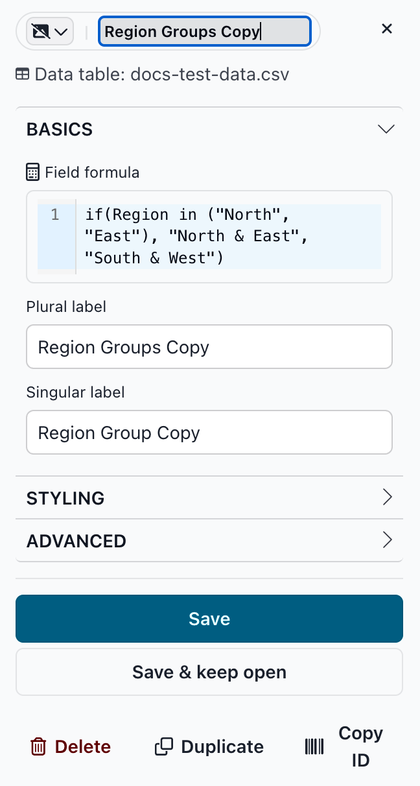
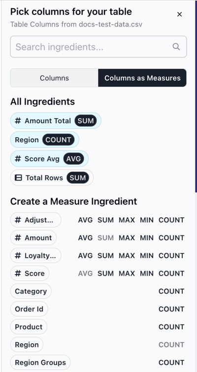

# Adding new ingredients

You can add an ingredient in three ways:

* Duplicate an existing dimension or measure, then change the copy.
* Create a measure from a column while you configure a slice.
* For a Map slice, create a place dimension. See [Creating a place](../slices/charts/map.md#creating-a-place).

### Duplicating an ingredient

1. Open the [ingredient editor](the-ingredient-editor/) for the ingredient you want to copy.
2. Click **Duplicate** at the bottom of the editor. Juicebox saves a copy right away, with "Copy" added to its labels (for example, "Region Copy"), and opens the copy in the editor. If you close the editor without saving, the copy stays as it is. To remove a copy you don't need, open it and click **Delete**.
3. Change the copy's **Field formula**, labels and other options. For example, to group regions into two areas, enter `if(Region in ("North", "East"), "North & East", "South & West")` as the **Field formula**, "Region Groups" as the **Plural label** and "Region Group" as the **Singular label**.
4. Click **Save** to save your changes.

<figure><figcaption></figcaption></figure>

To use the new ingredient, pick it from a slice's ingredient list.

### Creating a measure from a column

1. In a slice's CONFIG section, click the pencil icon on a field that takes measures, such as **Bars** on a Bar slice. This opens the ingredient list. In Table and Chooser slices, the list has two tabs, **Columns** and **Columns as Measures**: click **Columns as Measures**.
2. Under **Create a Measure Ingredient**, find the column and click an aggregation. Number columns show all five; other columns show **COUNT** only. An aggregation is grayed out when the column already has a measure with that aggregation.
   * **AVG**, **SUM**, **MAX** or **MIN**: the average, total, largest or smallest value.
   * **COUNT**: the number of distinct values in the column.

<figure><figcaption></figcaption></figure>

The new measure is added to the slice's field and to the ingredient list, so other slices can use it too. Juicebox names it after the column, for example "Amount Total" for the sum of Amount. To change its label or formula, click its pill to open the ingredient editor.

For other aggregations, or formulas that combine columns, duplicate a measure and change its **Field formula**. See [Advanced field formulas](advanced-formulas.md).
