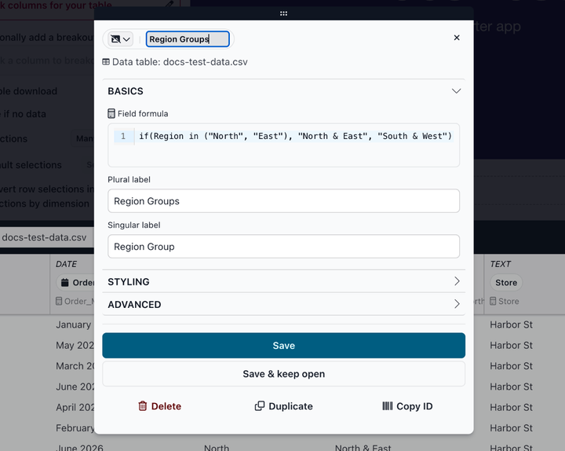
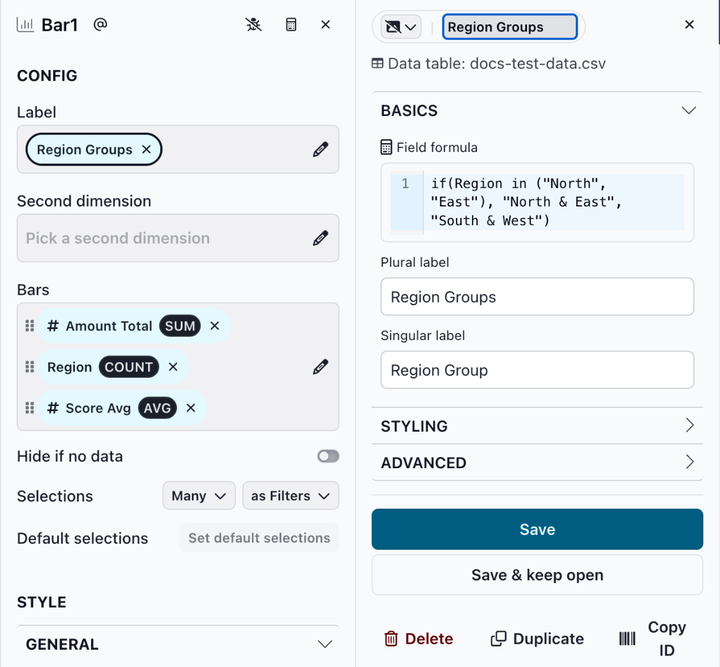

# The ingredient editor

The ingredient editor is where you view and change an ingredient: its formula, labels, formatting and other options. A change to an ingredient affects every slice that uses it. Saved changes go into the report's draft, like changes to slices, and reach viewers when you [publish your changes](../../../publish-and-share/publishing-app-changes.md).

### Opening the ingredient editor

Click an ingredient's pill:

* **In the data preview**: Click a dimension's pill at the top of the dimension. The editor opens in a dialog over the report. To move the dialog, drag the handle at its top.
* **In a slice's CONFIG section**: Click a dimension or measure pill in one of the slice's fields, such as **Label** or **Bars**. The editor opens in a panel next to the Editing Panel, and the pill you're editing gets a dark border.

<figure><figcaption></figcaption></figure>

<figure><figcaption></figcaption></figure>

### Working in the editor

The editor has three parts:

* At the top: the ingredient's icon and label, and the data table it comes from.
* The options, grouped into **Basics**, **Styling** and **Advanced** sections.
* At the bottom: the **Save**, **Save & keep open**, **Delete**, **Duplicate** and **Copy ID** buttons.

The options depend on whether the ingredient is a dimension or a measure. Number and date dimensions, and place dimensions (the dimensions Map slices use), have options of their own. The options and buttons are described on these pages:

* [The dimension ingredient editor](the-dimension-ingredient-editor.md)
* [The measure ingredient editor](the-measure-ingredient-editor.md)
