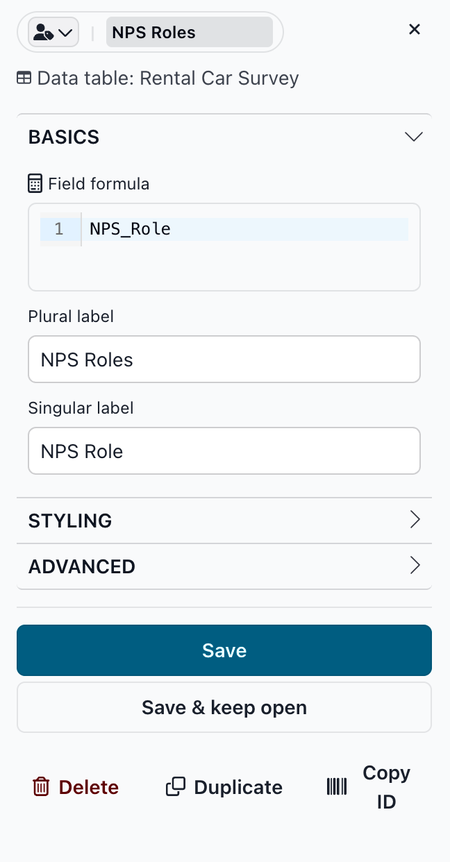
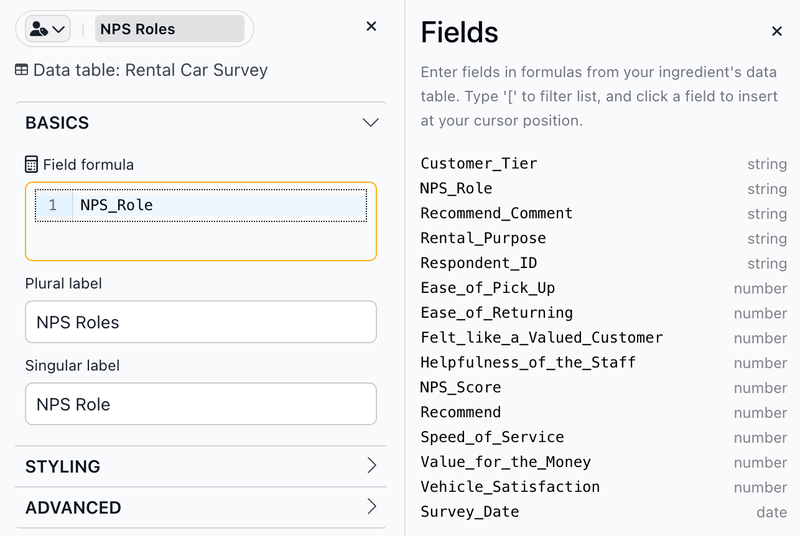
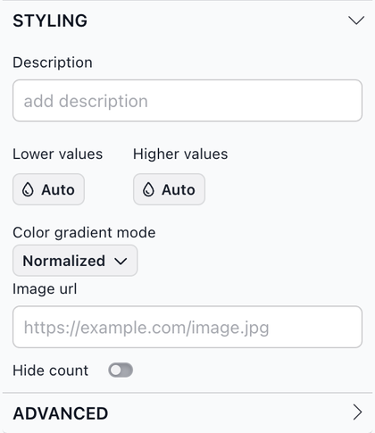
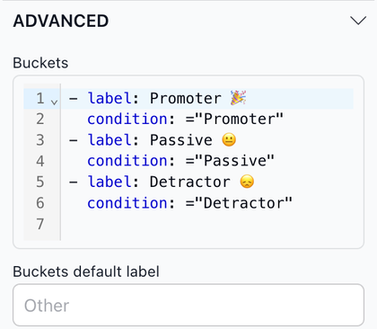

# The dimension ingredient editor

The dimension ingredient editor is where you set up a dimension: the data it uses, its labels, and how its values look in the report. The options are grouped into **Basics**, **Styling** and **Advanced** sections. Click a section name to expand or collapse it. Some options only appear for number, date or place dimensions.

### Working in the editor

<figure><figcaption></figcaption></figure>

* **Icon and label**: The pill at the top shows the dimension's icon and label. Click the icon to pick a different [Font Awesome](https://fontawesome.com/) icon or to remove it. Edit the label right in the pill. Editing it here also changes **Plural label** in Basics. By default, date dimensions show a calendar icon, number dimensions a hashtag (#), place dimensions a map marker, and text dimensions no icon.
* **Data table**: The name of the data table the dimension comes from.

The buttons at the bottom of the editor:

* **Save**: Saves your changes and closes the editor.
* **Save & keep open**: Saves your changes and keeps the editor open, so you can see the result in the report and keep adjusting.
* **Delete**: Deletes the dimension right away and removes it from any slices that use it.
* **Duplicate**: Saves a copy of the dimension with "Copy" added to its label (for example, "Region Copy") and opens the copy in the editor. This is a quick way to [add a new ingredient](https://docs.myjuicebox.io/building-reports/story-designer/ingredients/adding-new-ingredients) that is similar to an existing one.
* **Copy ID**: Copies the dimension's ingredient ID, the name Juicebox uses for it internally, to the clipboard.

To close the editor without saving, click the **×** in the top right corner. Unsaved changes are discarded.

### Basics

The Basics section holds the options you use most.

* **Field formula**: The column the dimension is based on, or a formula built from columns, for example `if(project_status in ("completed", "QA"), "Done", "Open")`. See [Advanced field formulas](https://docs.myjuicebox.io/building-reports/story-designer/ingredients/advanced-formulas).
* **Plural label**: The label used in most places in the report, such as filter pills and legends.
* **Singular label**: The label used where the report refers to one item, such as a Table column header. For example, "Region" when the plural label is "Regions".
* **Number format**: Only for number dimensions. Pick a format from the list, or type a custom [number format](https://docs.myjuicebox.io/building-reports/story-designer/ingredients/ingredient-formats) in the box below it. The default is **3 Sig figs** (`.3s`).
* **Time format**: Only for date dimensions. Pick a format from the list (for example **month dd, yyyy** or **month yyyy**), or type a custom [time format](https://docs.myjuicebox.io/building-reports/story-designer/ingredients/time-formats) in the box below it.


Date dimensions "roll up" in charts to the period of the **Time format**. For example, the **month yyyy** format rolls dates up to months, and **yyyy** rolls them up to years.


Place dimensions show **Places column to map** instead of **Field formula**, plus three more fields:

* **Places column to map**: The column that holds the place names or codes.
* **Latitude** and **Longitude**: The columns that hold each place's latitude and longitude.
* **Geometry Field**: The column that holds each place's shape as GeoJSON geometry.

**Inserting columns into a formula**

When you click in a formula box (such as **Field formula** or **Filter**), a **Fields** list opens next to the editor. It lists the columns in the dimension's data table and their types. Click a column to insert it at the cursor, in square brackets (for example `[Region]`). Formulas accept column names with or without brackets. To filter the list, type `[` followed by the start of a column name.

<figure><figcaption></figcaption></figure>

### Styling

<figure><figcaption></figcaption></figure>

* **Description**: A short explanation of the dimension. It appears as a tooltip, for example when a viewer hovers over the dimension's column header in a Table slice.
* **Lower values**, **Higher values** and **Color gradient mode**: Color settings that slices use for measure values. They are described on [The measure ingredient editor](https://docs.myjuicebox.io/building-reports/story-designer/ingredients/the-ingredient-editor/the-measure-ingredient-editor) page. To color individual dimension values, use **Item Styles** under Advanced.
* **Image url**: The web address of an image that represents the dimension.
* **Hide count**: By default, filter pills show the number of values next to the label, for example "4 Region". Turn this on to show only the label.

### Advanced

**Buckets**

Buckets group the dimension's values under new labels. In the **Buckets** box, give each bucket a `label` and a `condition`. Conditions are checked in the order they are listed, and each value goes into the first bucket whose condition it meets. A condition can name the column (`score <= 6`) or start with the comparison (`<= 6`), in which case it applies to the **Field formula**. See [conditional logic](https://docs.myjuicebox.io/building-reports/story-designer/ingredients/advanced-formulas#conditional-logic) for what conditions can contain.

For example, if your data has a `score` column with customer scores, these buckets group customers into Detractors, Passives and Promoters:

```yaml
- label: Detractor
  condition: score <= 6
- label: Passive
  condition: score <= 8
- label: Promoter
  condition: score <= 10
```

Because conditions are checked in order, buckets for ranges of numbers only need an upper limit:

```yaml
- label: Under 25k
  condition: <25000
- label: 25k-49k
  condition: <50000
- label: 50k-99k
  condition: <100000
```

**Buckets default label** is the label for values that don't meet any condition. If you leave it blank, they are labeled "Other".

<figure><figcaption></figcaption></figure>

**Lookups**

Lookups change how values are displayed without changing your data. In the **Lookups** box, list each value in the data followed by the value to display:

```yaml
value in data: value to display
value in data: value to display
```

For example, to show "United States" as "USA":

```yaml
United States: USA
```

Values that aren't in the list are displayed as they are.

**Other advanced options**

* **Id Field**: A column or formula that identifies each value, separate from the value shown in the report. Selections in the slice filter other slices by the ID. For example, with `customer_name` as the Field formula and `customer_id` as the Id Field, the slice shows customer names, but other slices are filtered by `customer_id`.
* **Order By**: A column or formula used to sort the dimension's values, instead of sorting by the values themselves. For date dimensions this is called **Order By Field**.
* **Filter**: A condition that limits which rows of the data table are used. Whenever the dimension is used in a slice, rows that don't meet the condition are left out of that slice. Because this affects every slice that uses the dimension, it's usually better to limit a slice's data with `filter_expression` in that slice's [Advanced configuration](../../slices/advanced-configuration.md).
*   **Item Styles**: Colors for individual values. For each value, enter the value and a color:

    ```yaml
    West:
      color: "#1f77b4"
    ```

    The color is used for that value in charts such as Pie and Bar, in legends, and in lists of values.
* **Reverse**: Reverses the sort order of the dimension's values, for example from Z to A instead of A to Z.
