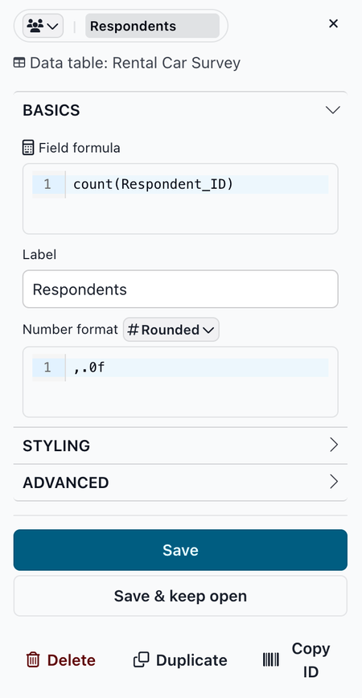
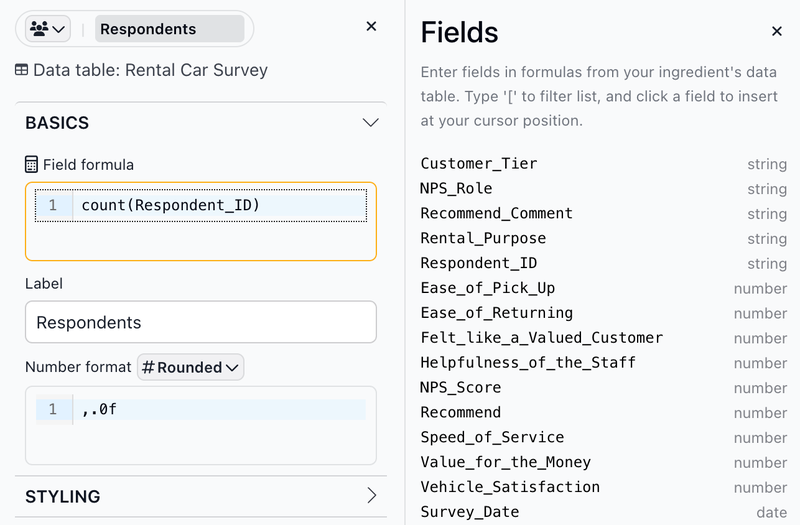
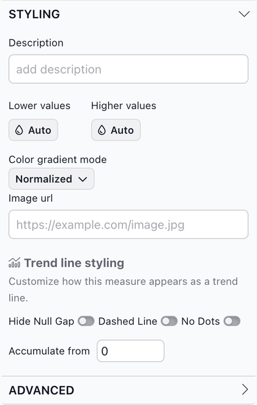
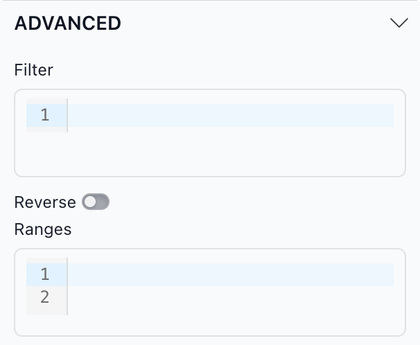

# The measure ingredient editor

The measure ingredient editor is where you set up a measure: how it is calculated, its label, and how its values look in the report. The options are grouped into **Basics**, **Styling** and **Advanced** sections. Click a section name to expand or collapse it.

### Working in the editor

<figure><figcaption></figcaption></figure>

* **Icon and label**: The pill at the top shows the measure's icon and label. Click the icon to pick a different [Font Awesome](https://fontawesome.com/) icon or to remove it. Edit the label right in the pill. Editing it here also changes **Label** in Basics.
* **Data table**: The name of the data table the measure comes from.

The buttons at the bottom of the editor:

* **Save**: Saves your changes and closes the editor.
* **Save & keep open**: Saves your changes and keeps the editor open, so you can see the result in the report and keep adjusting.
* **Delete**: Deletes the measure right away and removes it from any slices that use it.
* **Duplicate**: Saves a copy of the measure with "Copy" added to its label (for example, "Sales Total Copy") and opens the copy in the editor. This is a quick way to [add a new ingredient](https://docs.myjuicebox.io/building-reports/story-designer/ingredients/adding-new-ingredients) that is similar to an existing one.
* **Copy ID**: Copies the measure's ingredient ID, the name Juicebox uses for it internally, to the clipboard.

To close the editor without saving, click the **×** in the top right corner. Unsaved changes are discarded.

### Basics

The Basics section holds the options you use most.

* **Field formula**: How the measure is calculated, usually an aggregation of a column, for example `sum([Amount])` or `count(Respondent_ID)`. See [Advanced field formulas](https://docs.myjuicebox.io/building-reports/story-designer/ingredients/advanced-formulas) for the aggregation functions and for combining them.
* **Label**: The measure's label in the report.
* **Number format**: Pick a format from the list, or type a custom [number format](https://docs.myjuicebox.io/building-reports/story-designer/ingredients/ingredient-formats) in the box below it. The default is **3 Sig figs** (`.3s`).

**Inserting columns into a formula**

When you click in a formula box (such as **Field formula** or **Filter**), a **Fields** list opens next to the editor. It lists the columns in the measure's data table and their types. Click a column to insert it at the cursor, in square brackets (for example `[Amount]`). Formulas accept column names with or without brackets. To filter the list, type `[` followed by the start of a column name.

<figure><figcaption></figcaption></figure>

### Styling

<figure><figcaption></figcaption></figure>

* **Description**: A short explanation of the measure. It appears as a tooltip, for example when a viewer hovers over the measure's column header in a Table slice. Chooser slices can also show it with the measure.
* **Lower values** and **Higher values**: Colors for the measure's lower and higher values. Click a button to choose a color or a theme swatch, or click **Reset to Auto** to go back to the report's theme colors. Table slices use these colors for **Cell coloring** (see [Table](https://docs.myjuicebox.io/building-reports/story-designer/slices/charts/table)). The **Higher values** color is also the measure's line color in Trend slices.
* **Color gradient mode**: How colors are spread across the values when a gradient is used. **Normalized** makes a smooth gradient from **Lower values** to **Higher values** across the range of values. **Bands** splits the range into a fixed number of equal bands, each with one color, which helps group values into categories. With **Bands**, choose the **Number of bands** (5 or 10).
* **Image url**: The web address of an image that represents the measure. Chooser slices show it with the measure.

**Trend line styling**

These options change how the measure looks as a line in a Trend slice:

* **Hide Null Gap**: Connects the line across periods with no data, instead of leaving a gap.
* **Dashed Line**: Draws the line dashed.
* **No Dots**: Removes the dots from the line.
* **Accumulate from**: The starting value when the Trend slice's **Accumulate measures** option is on. For example, with **Accumulate from** set to 100000, the line starts at 100,000 plus the first period's value. The default is 0.

### Advanced

<figure><figcaption></figcaption></figure>

* **Filter**: A condition that limits which rows of the data table the measure uses. Rows that don't meet the condition don't count toward the measure in any slice that uses it, so in a slice that groups by a dimension, values with no matching rows don't appear. In most cases it's better to limit a slice's data with `filter_expression` in that slice's [Advanced configuration](../../slices/advanced-configuration.md).
* **Reverse**: Turn this on when lower values are better, for example for wait times or costs. By default, higher values are treated as better. Reverse flips this, for example in [Leaderboard](https://docs.myjuicebox.io/building-reports/story-designer/slices/charts/leaderboard) slices and in Chooser comparisons, and it inverts the measure's axis in Scatterplot slices.
* **Ranges**: Named ranges of values, each with a color. Ranges are needed to show gauges in [Chooser](https://docs.myjuicebox.io/building-reports/story-designer/slices/charts/data-card) and [Card](https://docs.myjuicebox.io/building-reports/story-designer/slices/charts/card) slices, and to color Table cells when **Cell coloring** is set to **Measure Range Colors**.

Here's an example of ranges for a sales measure:

```yaml
- color: "#ee6055"
  label: Below
  endValue: 4000000
  startValue: 0
- color: "#eaf4f4"
  label: On Target
  endValue: 5500000
- color: "#60d394"
  label: Above
  endValue: 20000000
```

This defines three ranges: "Below" from 0 to 4 million, "On Target" up to 5.5 million, and "Above" up to 20 million. A range without a `startValue` starts where the range before it ends. Colors are hex codes.
