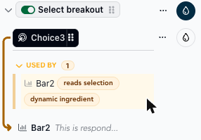
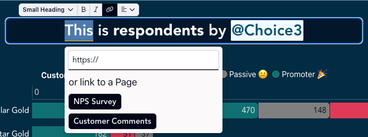
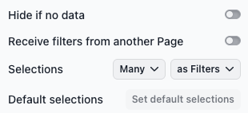
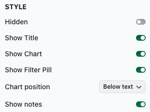
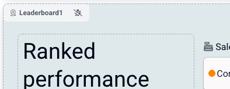
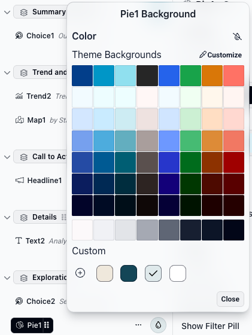

# Slices

Slices are the basic building blocks of your story. Slices are added to [sections](../sections.md). Each slice can have text either by itself or with media (image or video) or a [chart](charts/).

## Adding, duplicating, and deleting slices

You add and manage slices in the outline of the Editing Panel, which lists the slices in each section.

To add a slice, hover over the outline where you want the slice to go and click the **+** button that appears. Then select the slice type from the menu. **Media** opens a submenu where you can upload an image, find images, or paste an image URL. **YouTube** and **Vimeo** add a video. The new slice is added to the draft and opens in the Editing Panel.

<figure><figcaption></figcaption></figure> <figure><figcaption></figcaption></figure>

Rather than adding a brand new slice, it may be easier to duplicate and modify an existing slice. To duplicate a slice, hover over it in the outline, click the **…** button next to it, and select **Duplicate**.

To delete a slice, click the **…** button and select **Delete**.

<figure><figcaption></figcaption></figure>

Before the slice is deleted, a confirmation lists any other slices that depend on it and how, for example by reading its selections. References to the deleted slice in those slices will break. Click **Delete** to delete the slice, or **Cancel** to keep it.

<figure><figcaption></figcaption></figure>

## Seeing how slices depend on each other

When you select a slice in the outline, up to two lists appear below it:

* **Uses**: slices that this slice depends on.
* **Used by**: slices that depend on this slice.

Each list starts collapsed and shows how many slices it contains. Click its heading to expand it. Labels next to each slice describe the dependency, such as **reads selection**, **dynamic ingredient**, **passes variables** or **embeds pill**. Hover over a slice in the list to draw an arrow to it in the outline, or click it to go to that slice.

<figure><figcaption></figcaption></figure>

## Adding slice content

Every slice can have text and either a chart or media (an image or video). To add text to a slice, click in the draft report where you want the text to appear and type. A toolbar above the text lets you set the text style, make text bold or italic, add a link, and set the alignment.

<figure><figcaption>
Text is added and styled directly in the draft report
</figcaption></figure>

Until you configure your chart, the chart will display a "This slice has potential" message.

<figure><figcaption>
This message will display if the chart has not been configured
</figcaption></figure>

### Linking to a page

For reports with [multiple pages](https://docs.myjuicebox.io/building-reports/story-designer/report-settings#manage-pages), you can create links in slice text that go to another page in the same report. Select the text, click the link button in the toolbar, and click a page name under **or link to a Page**. This list appears only when the report has more than one page.

<figure><figcaption></figcaption></figure>

Links created this way navigate to the target page without a full browser reload and carry forward any active filter selections. This means viewers keep their current context as they move between pages.


If you manually add query parameters or hash fragments to the link URL, the link will open in a new browser tab instead of navigating within the report.


## Common slice configuration options

Each slice type has its own options in the Editing Panel, but many options are shared by several slice types. Not every slice type has all of them. The page for each [chart type](https://docs.myjuicebox.io/building-reports/story-designer/slices/charts) describes the options specific to that type.

### CONFIG section

**Data Table**. Appears only when more than one data table is connected to the report. The slice uses the selected data table.

**Hide if no data**. If turned on, the entire slice is hidden when all of its data has been filtered out. If turned off, the slice shows a message telling the viewer that all data has been filtered out.

**Receive filters from another Page**. For reports with [multiple pages](https://docs.myjuicebox.io/building-reports/story-designer/report-settings#manage-pages), this toggle controls whether the slice applies matching filter selections from the page the viewer came from. When it's on, selections from that page are applied automatically if the filter dimensions match. This toggle appears only in reports with more than one page.

**Selections**. Two buttons control what viewers can select in the slice and what their selections do.

* The first button sets how many items a viewer can select: **Select many**, **Select one required**, **Select up to one**, or **Don't allow selection**. On Filter and Map slices, you set this separately for each dimension.
* The second button sets how selections are used:
  * **as Filters**. This is the default. Selections filter downstream slices.
  * **as Variables**. Selections don't filter downstream slices. Instead, the selected values are saved as variables that you can use when defining ingredients.
  * **as Filters/Variables**. Selections filter downstream slices and are saved as variables.

Chooser slices have only the second button.


Variables are very powerful. Learn more [here](selections-as-variables.md).


**Default selections**. Sets which items are selected when someone first views the slice. Make the selections in the draft report, then click **Set default selections**. Viewers can still change the selections, and clearing them goes back to the defaults. Learn more in [Default selections](https://docs.myjuicebox.io/building-reports/story-designer/slices/default-selections).

<figure><figcaption></figcaption></figure>

### STYLE section

On some slice types, such as Bar and Trend, the STYLE options are grouped into collapsible sections such as **General** and **Accessibility**. Click a section heading to expand it.

**Display options**. These toggles control which parts of a slice viewers see.

* **Hidden**. Hides the entire slice from viewers. When this is on, the other display toggles are hidden, and the slice is dimmed in the outline with a crossed-out eye icon. This is useful when you want a slice to set [variables](https://docs.myjuicebox.io/building-reports/story-designer/slices/selections-as-variables) without showing anything in the report.
* **Show Title**. Shows or hides the slice header. On by default.
* **Show Chart**. Shows or hides the chart or main content. On by default. The label varies by slice type: it reads "Show Filters" on a Filter slice and "Show Reports" on a Reports Navigation slice.
* **Show Filter Pill**. Shows or hides the slice's filter pill. On by default. When you want filter behavior without displaying the full chart, turn off **Show Chart** and leave **Show Filter Pill** on. This option isn't available on Chooser, Filter, Media or Reports Navigation slices.
* **Show as Download Button**. Table slices only. Replaces the table with a button that lets viewers download the data. Turning it on hides the chart and the filter pill.


Combining **Hidden** with [variables](selections-as-variables.md) and [dynamic text](dynamic-text.md) is a powerful pattern — use a hidden slice to capture selections as variables, then reference those variables in dynamic text or ingredient formulas elsewhere in the report.


**Chart position**. Sets where the chart appears relative to the slice text. Media slices call this **Media position** and have their own options: **Media below text** (the default), **Feature text left** (the text on the left with more room, the media on the right), **Media above text**, **Media on right** and **Media on left**. Other slice types have these options:

* **Below text**: the chart appears below the slice text. This is the default.
* **Above text**: the chart appears above the slice text.
* **Right of text**: the text is on the left and the chart is on the right.
* **Left of text**: the chart is on the left and the text is on the right.

**Show legend**. Some charts have legends. Turn this off to hide the legend.

**Show notes**. Notes give extra information about the chart data, for example when values are missing or how the data is filtered. On by default.

**Filters applied footnote**. Turn it on to add a footnote listing the filters applied to the slice, for example "Filters: NPS Roles: Detractor." Turn on **Filters footnote minimal** for a shorter summary, such as "Filters: 1 NPS Role." On slice types that have **Show notes**, this option appears only when **Show notes** is on.

**Chart accessible name**. Chart slices only. The name screen readers announce for the chart. Describe what the chart shows, for example "Revenue by region." If you leave it empty, the slice slug (for example, Pie1) is used.

<figure><figcaption></figcaption></figure>

### Slice slugs

Each slice has a unique ID called a "slug". Slices with text only or media have a slug like **Text1** or **Text5**. Slices with charts have a slug like **Table1** or **Scatterplot2**. In Edit mode, each slice shows its slug as a badge in its top-left corner. Click the badge to open the slice in the Editing Panel.

<figure><figcaption></figcaption></figure>

The slug also appears at the top of the Editing Panel. Slugs are how slices refer to each other, for example in [dynamic text](https://docs.myjuicebox.io/building-reports/story-designer/slices/dynamic-text) or when a slice uses a Chooser's selection (such as **@Choice2**). To copy a reference to the slice, click the **@** button next to the slug. On a Filter slice, the **@** button lets you choose which filter to copy. The buttons on the right open the [debug view](https://docs.myjuicebox.io/building-reports/story-designer/slices/debug) and [advanced configuration](https://docs.myjuicebox.io/building-reports/story-designer/slices/advanced-configuration) for the slice.

<figure><figcaption>
Click the <strong>@</strong> button to copy the slice slug
</figcaption></figure>

### Slice backgrounds

By default, slices have a transparent background, so the section background shows through. To change it, hover over the slice in the outline and click the paint-drop icon next to it. Pick a color under **Theme Backgrounds**, or click **+** under **Custom** to pick a color or enter a hex code, then click **Save**. Custom colors are saved with the report, so they appear under **Custom** for every slice. Click **Customize** to change the color theme. To go back to a transparent background, click the crossed-out paint-drop icon next to **Color**.

<figure><figcaption></figcaption></figure>

## Reordering slices

To reorder slices, drag a slice by the handle next to its name in the outline. You can move slices within a section or to a different section.
