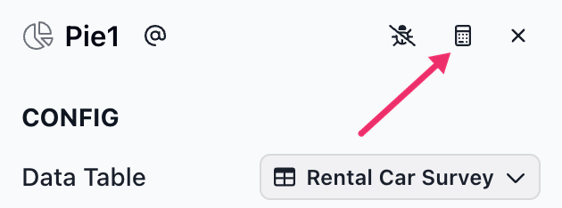
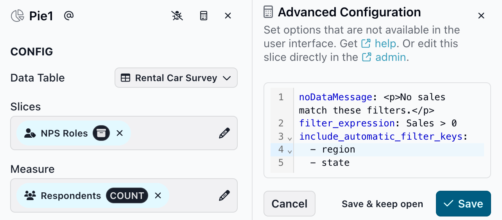

# Advanced configuration

Some slice options aren't in the Editing Panel. You can set them in the **Advanced Configuration** panel.


Advanced configuration is available to editors, admins and owners.


### Opening Advanced Configuration

Open a slice in the Editing Panel and click the calculator button at the top right of the panel, next to the close button. The button is filled in when the slice already has advanced configuration.

<figure><figcaption></figcaption></figure>

The **Advanced Configuration** panel opens next to the Editing Panel. Enter options in YAML, one per line, as `option: value`. For example:

```yaml
noDataMessage: <p>No sales match these filters.</p>
filter_expression: Sales > 0
include_automatic_filter_keys:
  - region
  - state
```

Click **Save** to save and close the panel, or **Save & keep open** to keep working. Click **Close** (or **Cancel** if you have unsaved edits) to leave without saving. Like other edits, these changes are part of the draft until you publish.

<figure><figcaption></figcaption></figure>

When you save:

* Options that aren't on this page are removed. Check the panel after saving to see what was kept.
* A value of the wrong type (for example, text where a number is needed) isn't saved. The panel shows **Validation failed** and lists each problem.
* If the YAML can't be read, the panel shows **Something is wrong** with the error as you type, and you can't save until it's fixed.


Advanced configuration is applied every time the slice is saved. If an option here also has a control in the Editing Panel (for example **Show Top** on a Leaderboard), the value here wins. Remove the option from Advanced Configuration to go back to using the control.


### Slice configuration options

| Option             | Description                                                                                                                                                                                                                                                                    | Data type                                                | Slices             |
| ------------------ | ------------------------------------------------------------------------------------------------------------------------------------------------------------------------------------------------------------------------------------------------------------------------------ | -------------------------------------------------------- | ------------------ |
| noDataMessage      | An HTML message to show when the slice has no data. Invalid HTML is removed.                                                                                                                                                                                                   | Text containing HTML                                     | All slices         |
| minSelections      | The minimum number of items that must be selected. Items are selected automatically to reach it. Gives more flexibility than **Selections** in the CONFIG section.                                                                                                             | Integer                                                  | All slices         |
| maxSelections      | The maximum number of items that can be selected. Gives more flexibility than **Selections** in the CONFIG section.                                                                                                                                                            | Integer                                                  | All slices         |
| minZoom            | How far out the map can zoom. Default is 1.                                                                                                                                                                                                                                    | Integer                                                  | Map                |
| maxZoom            | How far in the map can zoom.                                                                                                                                                                                                                                                   | Integer                                                  | Map                |
| colorRange         | The colors used to color map bubbles by the color measure.                                                                                                                                                                                                                     | List of hex colors, for example `["#FD938B", "#84BB38"]` | Map                |
| x\_bounds          | The minimum and maximum of the X axis. Use it when the data doesn't cover the full range you want to show (for example, data from 5 to 20 on a 0 to 100 scale). By default the axis fits the data.                                                                             | List of two numbers, for example `[0, 100]`              | Scatterplot        |
| invertXAxis        | Reverses the X axis so the highest value is on the left. Default is false, unless the X measure is set to reverse.                                                                                                                                                             | true or false                                            | Scatterplot        |
| h\_lines, v\_lines | Where the region lines fall. `h_lines` sets the rows and `v_lines` the columns. Each item is the size of one region in percent; the last region takes the rest. `["50%"]` makes two equal regions. The default makes three. Usually set with **Regions** in the STYLE section. | List of percentages, for example `["25%", "50%"]`        | Scatterplot        |
| numberOfRows       | The number of rows to show. Usually set with **Show Top** in the STYLE section. Default is 10.                                                                                                                                                                                 | Integer                                                  | Leaderboard        |
| includeAppSlugs    | The reports to list, in this order. Only published reports the viewer has access to are shown, and the current report is never listed.                                                                                                                                         | List of report slugs                                     | Reports Navigation |

The panel also accepts `layout`, `layoutFlags` and `selectionPolicy`. These hold settings that the Editing Panel manages (the display toggles, Selections and Default selections), so set them there instead. `min_value`, `max_value` and `colorRange` also apply to legacy Ranked List slices.

### Data configuration options

Data options control what data the slice shows. They change the SQL queries the slice runs and how the results are filtered and cached.

| Option                           | Description                                                                                                 | Data type                                       | Slices                               |
| -------------------------------- | ----------------------------------------------------------------------------------------------------------- | ----------------------------------------------- | ------------------------------------ |
| include\_automatic\_filter\_keys | The automatic filters to apply. Filters **not on this list** are ignored.                                   | List of text                                    | All slices                           |
| exclude\_automatic\_filter\_keys | The automatic filters to ignore.                                                                            | List of text                                    | All slices                           |
| automatic\_filters               | Filter keys and values that are always applied to this slice. `filter_expression` is preferred.             | Dictionary                                      | All slices                           |
| filter\_expression               | One or more expressions that limit the data in this slice. Each must evaluate to true or false.             | Text, or a list of text                         | All slices                           |
| order\_by\_expression            | One or more expressions that set the order of the data.                                                     | Text, or a list of text                         | All slices                           |
| apply\_automatic\_filters        | Whether data permissions and selections from other slices filter this slice. Default is true.               | true or false                                   | All slices                           |
| strict\_automatic\_filters       | Whether every key in the viewer's data permissions must exist in this slice's data source. Default is true. | true or false                                   | All slices                           |
| cache\_region                    | How long query results are cached. Each database connection has a default, set by Juicebox support.         | One of `1-second`, `2-hours`, `1-day`, `1-year` | All slices                           |
| group\_by\_type                  | The filter key that this slice's selections are sent as. By default it's the slice's dimension.             | Text                                            | Slices with dimensions (not Chooser) |

### Comparison configuration options

A Chooser that shows measures can show a comparison value for each measure. By default the comparison uses the same data as the chooser; these options change it.

<figure><figcaption><p>A Chooser with comparisons</p></figcaption></figure>

All comparison options start with `comparison_`.

| Option                                       | Description                                                                                                                                                                                 | Data type                                       | Slices  |
| -------------------------------------------- | ------------------------------------------------------------------------------------------------------------------------------------------------------------------------------------------- | ----------------------------------------------- | ------- |
| comparison\_exists                           | Adds a comparison even when no other comparison option is set.                                                                                                                              | true or false                                   | Chooser |
| comparison\_label                            | The label for the comparison value. Default is "vs. Comparison".                                                                                                                            | Text                                            | Chooser |
| comparison\_metrics                          | The comparison for each measure in the chooser, in the same order. Use numbers for fixed values, or measure IDs to compare against other measures. The list must have one item per measure. | List of numbers, or list of measure IDs         | Chooser |
| comparison\_apply\_automatic\_filters        | Whether selections from other slices filter the comparison.                                                                                                                                 | true or false                                   | Chooser |
| comparison\_include\_automatic\_filter\_keys | The automatic filters to apply to the comparison. Filters **not on this list** are ignored.                                                                                                 | List of text                                    | Chooser |
| comparison\_exclude\_automatic\_filter\_keys | The automatic filters to ignore for the comparison.                                                                                                                                         | List of text                                    | Chooser |
| comparison\_automatic\_filters               | Filter keys and values that are always applied to the comparison.                                                                                                                           | Dictionary                                      | Chooser |
| comparison\_strict\_automatic\_filters       | Whether every key in the viewer's data permissions must exist in the comparison's data source.                                                                                              | true or false                                   | Chooser |
| comparison\_filter\_expression               | One or more expressions that limit the data used for the comparison. Each must evaluate to true or false.                                                                                   | Text, or a list of text                         | Chooser |
| comparison\_order\_by\_expression            | One or more expressions that set the order of the comparison data.                                                                                                                          | Text, or a list of text                         | Chooser |
| comparison\_cache\_region                    | How long comparison query results are cached.                                                                                                                                               | One of `1-second`, `2-hours`, `1-day`, `1-year` | Chooser |
