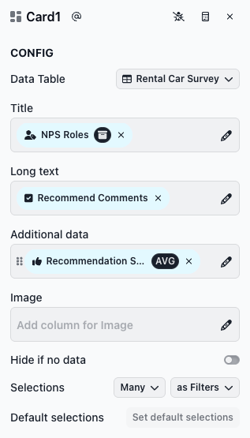
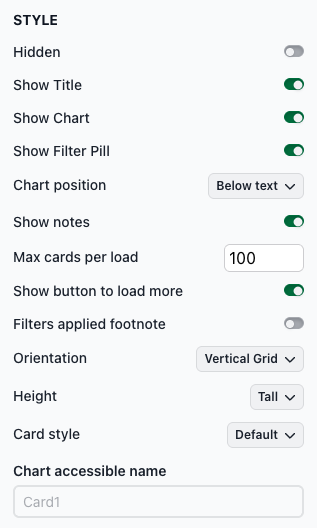
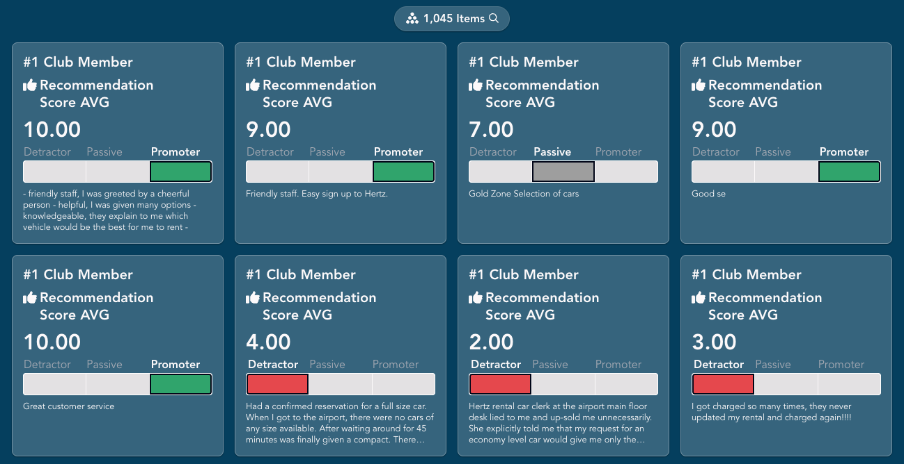
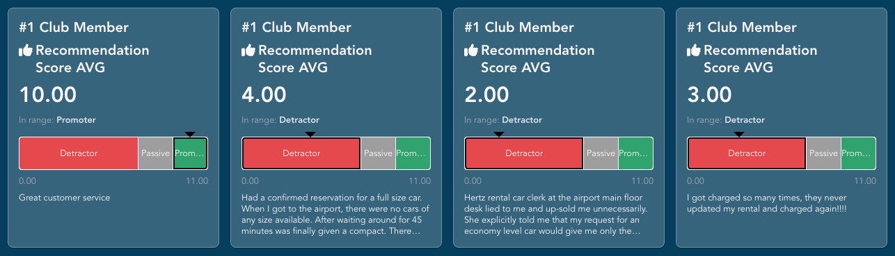
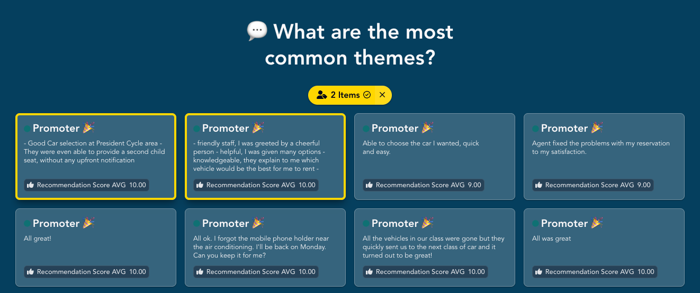

# Card

The Card slice displays dimension and measure values on cards. Users can select cards to filter downstream results. Here's an example of a Card slice:

<figure><figcaption><p>Example Card slice</p></figcaption></figure>

## Adding a card slice

To add a card slice, select **Card** from the chart list.

<figure><figcaption></figcaption></figure>

**Configuring the card slice**

The CONFIG section has the following fields:

* **Title**: A dimension whose values appear as the card titles.
* **Long text**: A dimension whose values appear as the body text of each card.
* **Additional data**: One or more measures whose values appear on each card.
* **Image**: A dimension whose values are image URLs. The image appears on each card.
* **Hide if no data**: Toggle to hide the slice when no data is available.
* **Selections**: Controls how many cards a user can select and how those selections affect downstream slices.

**Title**, **Long text**, **Additional data** and **Image** are each optional, but you must fill in at least one. With none, the slice shows a "Can't fetch data" message. There is one card for each distinct combination of **Title**, **Long text** and **Image** values. If you fill in only **Additional data**, you get a single card with the totals. In most cases you'll want a **Title**.

<figure><figcaption></figcaption></figure>

**Style options**

The STYLE section includes several options for customizing how the cards look. Key Card-specific options:

* **Max cards per load**: The number of cards shown at first. The default is 250. Turn on **Show button to load more** to add a **Load more** button at the end of the cards that loads the next set.
* **Orientation**: How the cards are arranged. **Vertical Grid** (default) puts cards in up to four columns, depending on the width of the slice. **Horizontal Scroll** puts them in a single row that users scroll sideways. **Wrap cards** lays out fixed-width cards in centered rows, and the slice grows tall enough to show every loaded card.
* **Height**: Shown only for **Vertical Grid**. Sets the maximum height of the slice: Short, Default or Tall. When the cards don't fit, a **Load more** button at the bottom lets users scroll through the rest inside the slice.
* **Card style**: The layout of each card.
  * **Default**: The title, the long text, and the Additional data values as small labels along the bottom.
  * **2 Columns**: The text and values on the left and the image on the right. Without an image, the Additional data values are listed one per line.
  * **Quotes**: The long text as a quote, followed by the title and the Additional data values as small labels.
  * **Large Measure**: The title, then each Additional data measure with its name and a large value, then the long text.
  * **Detail Gauge** and **Simple Gauge**: Each Additional data measure with its value and a gauge built from the measure's ranges (see below). Measures without ranges show only the value.
* **Chart accessible name**: The name screen readers announce for the cards. Describe what they show, for example "Customer comments by NPS role." If left empty, the slice slug (for example, Card1) is used.

<figure><figcaption></figcaption></figure>

## Displaying cards with measure gauges

The **Detail Gauge** and **Simple Gauge** card styles show each Additional data measure on a gauge. The gauge is built from ranges defined on the measure, so set those up first:

1. In **Additional data**, click the measure to open the measure ingredient editor.
2. Expand **ADVANCED**.
3. In **Ranges**, add one entry per range, from lowest to highest. Each entry has a `label`, a `color` (a color name or hex code) and an `endValue`. Give the first range a `startValue` too. Each later range starts where the one before it ends.
4. Click **Save**.

These are the ranges used in the examples below, for a recommendation score from 0 to 10:

```yaml
- color: "#e5484d"
  label: Detractor
  startValue: 0
  endValue: 7
- color: "#9e9e9e"
  label: Passive
  endValue: 9
- color: "#30a46c"
  label: Promoter
  endValue: 11
```

A value is in a range when it is at least the range's start and less than its end. That's why the last range ends at 11: with an end of 10, a score of exactly 10 would fall outside every range and the gauge would show no range for it. Set the last `endValue` a little above the highest possible value.

**Simple Gauge** shows the range labels above equal-width segments and colors only the segment the value falls in.

<figure><figcaption></figcaption></figure>

**Detail Gauge** sizes each segment by the width of its range and colors all of them. An arrow marks the value, "In range" names its range, and the lowest and highest values appear below the gauge.

<figure><figcaption></figcaption></figure>

## Using a card slice

**Selecting cards**

Click a card to select it. Click more cards to add them to the selection. Selected cards are outlined, and the filter pill shows the selection: the card's title and text for a single card, or a count for several (for example, "2 Items"). Click a selected card to unselect it, or click the ✕ on the filter pill to clear all selections. Selections filter downstream slices.

<figure><figcaption></figcaption></figure>

**Expanding a card**

When a card has an image or long text that's cut off, hover over it to show the expand button in its top-right corner. Click it to open the full card in a window. Expanding a card doesn't select it.

**Using the keyboard**

* Press **Tab** to move to a card.
* Press **Enter** or **Space** to select or unselect it.
* If the slice doesn't allow selections, its cards are skipped when you press **Tab**.
