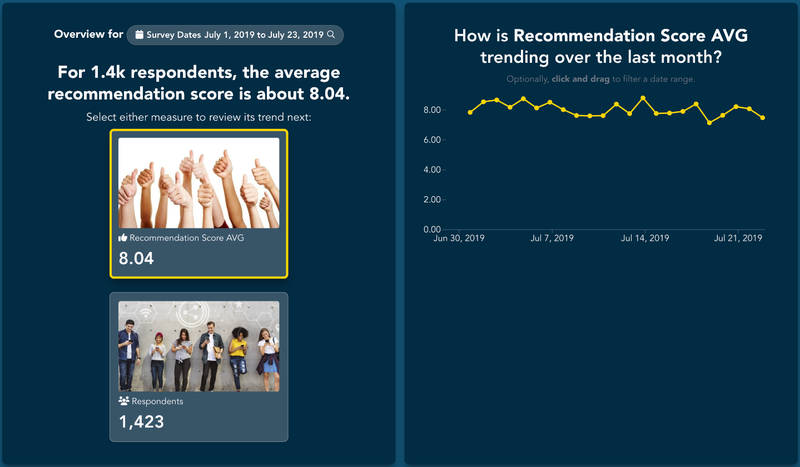
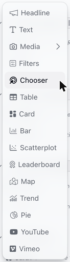
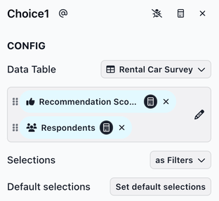
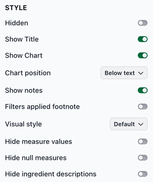
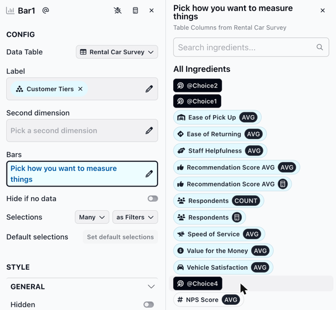
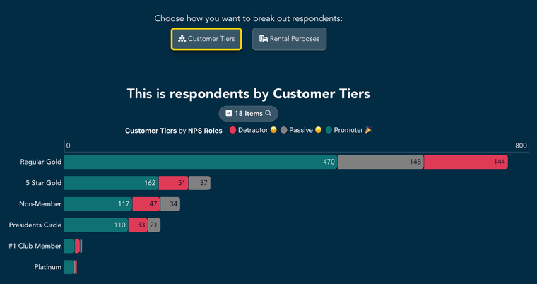

# Chooser

The Chooser slice shows a set of measures or columns that viewers can choose from. Slices further down the report can use the choice, so viewers decide what those slices show.

A chooser can:

* show a summary of key measures
* let viewers choose which measure other slices show
* let viewers choose which column other slices break the data out by

<figure><figcaption></figcaption></figure>

### Adding a chooser slice

To add a chooser slice, select **Chooser** from the chart list.

<figure><figcaption></figcaption></figure>

**Configuring the chooser slice**

The CONFIG section has the following fields:

* **Pick multiple measures or columns**: The options viewers choose from, in the order they appear. Drag them to reorder. The picker has two tabs: **Columns** and **Columns as Measures**. A chooser holds either columns or measures, not both. Picking from the other tab replaces what you've already picked.
* **Selections**: The **Select as** menu sets whether viewers' choices can also be used in formulas and labels. Choose **Variables** or **Filters and Variables** to use the choice as `{{Choice1}}` (named after the chooser's slug). See [Selections as variables](https://docs.myjuicebox.io/building-reports/story-designer/slices/selections-as-variables).
* **Default selections**: The option selected when the report opens. This becomes available once another slice uses the chooser. Without a default, the first option is selected.

<figure><figcaption></figcaption></figure>

**Style options**

The STYLE section includes the display options shared by most slices (see [Slices](https://docs.myjuicebox.io/building-reports/story-designer/slices)). Key Chooser-specific options:

* **Visual style**: How each option is laid out, in both measure and column choosers.
  * **Default**: The measure's image (if it has one), icon and name, then its value and description.
  * **2 Columns**: The name, value and description on the left and the image on the right.
  * **Quotes**: The description as a quote, with the image beside it, followed by the name and value as a small label.
  * **Comparisons**: Each measure's value next to a comparison value, with the difference highlighted in green or red. Set up the comparison in [Advanced configuration](https://docs.myjuicebox.io/building-reports/story-designer/slices/advanced-configuration#comparison-configuration-options). Without it, only the values show.
  * **Detail Gauge** and **Simple Gauge**: Each measure's value on a gauge built from the measure's ranges. See [Card](https://docs.myjuicebox.io/building-reports/story-designer/slices/charts/card#displaying-cards-with-measure-gauges) for how to set up ranges.
* **Hide measure values**: Hides the numbers, so each option shows only its name. Useful when the chooser is just a set of buttons.
* **Hide null measures**: Hides any measure whose value is empty. Without it, an empty measure shows "---".
* **Hide ingredient descriptions**: Replaces each option's description with an info icon. Viewers hover over the icon to read the description. A measure's description and image are set in the **STYLING** section of the measure editor.

<figure><figcaption></figcaption></figure>

### Connecting a chooser to other slices

A chooser is most useful when slices below it use its selection.

1. Add the chooser above the slices it should control.
2. In a slice below it, open the measure picker (for a measure chooser) or the column picker (for a column chooser). The chooser appears in the list by its slug, for example **@Choice1**.
3. Select it.

<figure><figcaption></figcaption></figure>

The slice now shows whichever option is selected in the chooser.

<figure><figcaption></figcaption></figure>


Until another slice uses the chooser, its options are display only: viewers can't select them. A chooser like this is a simple way to show a summary of key measures.



If you change a chooser from measures to columns (or back), slices that use it show an error until you update them.


You can also use the chooser's selection in slice text. See [Dynamic text](https://docs.myjuicebox.io/building-reports/story-designer/slices/dynamic-text).

### Using a chooser slice

**Selecting an option**

Click an option to select it. The selected option is outlined, and slices that use the chooser update. One option is always selected: when the report opens, it's the report's default selection, or the first option if there isn't one. Clicking the selected option again doesn't unselect it.

**Using the keyboard**

* Press **Tab** to move to an option.
* Press **Enter** or **Space** to select it.
* If no slice uses the chooser, its options are skipped when you press **Tab**.
