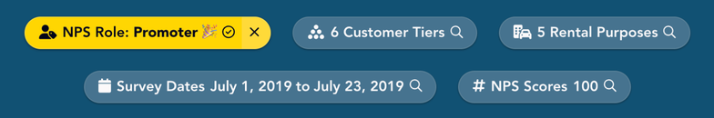
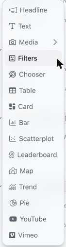
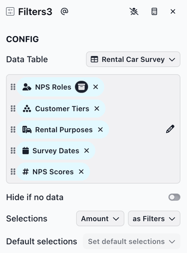
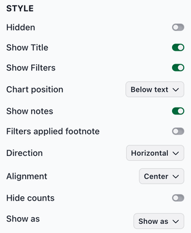
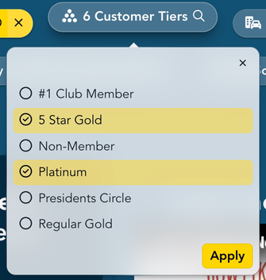
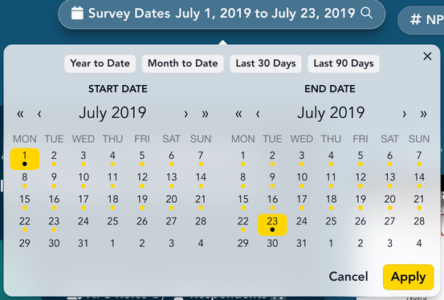

# Filters

The filter slice lets viewers narrow down the data in a report. Each column you add to the slice appears as a filter pill. Viewers click a pill and choose values, and the slices further down the report update to show only the matching data.

<figure><figcaption></figcaption></figure>

### Adding a filter slice

To add a filter slice, select **Filters** from the chart list.

<figure><figcaption></figcaption></figure>

**Configuring the filter slice**

The CONFIG section has the following fields:

* **Pick columns to filter on**: The columns viewers can filter by. Each column becomes a pill, in the order shown in this field.
* **Hide if no data**: Hides the entire slice when all of its data has been filtered out.
* **Selections**: **Amount** sets how many values viewers can select, separately for each filter: **Select many** (the default), **Select one required**, **Select up to one** or **Don't allow selection**. **Select as** sets whether selections are used as filters, variables or both. See [Common slice configuration options](https://docs.myjuicebox.io/building-reports/story-designer/slices#common-slice-configuration-options).

<figure><figcaption></figcaption></figure>

**Style options**

The STYLE section includes the display options shared by most slices (see [Common slice configuration options](https://docs.myjuicebox.io/building-reports/story-designer/slices#common-slice-configuration-options)). Key Filter-specific options:

* **Direction**: **Horizontal** (the default) places the pills side by side, wrapping onto more rows when needed. **Vertical** stacks them.
* **Alignment**: Places the pills on the **Left**, in the **Center** (the default) or on the **Right** of the slice.
* **Hide counts**: Removes the numbers from the pills, so "6 Customer Tiers" reads "Customer Tiers".
* **Show as**: Sets how each text filter appears. **Dropdown** (the default) shows a pill that opens a list of values. **Checkbox** shows every value in the slice as a button viewers can check, with an **Apply** button below.

<figure><figcaption></figcaption></figure>

### Using a filter slice

**Choosing values**

Click a pill to open its list of values. Click values to check them, then click **Apply**. The list closes and the slices further down the report update. If you close the list without clicking **Apply**, the filter doesn't change.

When a filter has more than 10 values, the list has a search field at the top. Type to narrow the list. **Select all** checks every matching value. It appears when the filter allows many selections and 11 to 250 values match.

<figure><figcaption></figcaption></figure>

**Reading a pill**

A pill with a selection is highlighted and shows a check mark. The text in the pill changes with the selection:

* With nothing selected, it shows how many values the filter has, for example "6 Customer Tiers".
* With one value selected, it shows that value, for example "Customer Tier: 5 Star Gold".
* With several values selected, it shows how many are selected, for example "2 NPS Roles". Hover over the pill to see which values they are.

Click the **×** on a highlighted pill to clear its selection. If the pill has a default selection, **×** puts the default back. A pill that shows its default selection has no ×.

The **Amount** setting changes how some pills behave:

* With **Select one required**, the pill always has one value selected, and there's no **×**.
* With **Don't allow selection**, the pill shows its name but doesn't open.

**How pills affect each other**

Each pill lists only the values that match the selections in the other pills of the same slice. For example, once a customer tier is selected, the Rental Purposes pill lists only the rental purposes of customers in that tier. A pill's own selection doesn't shorten its own list, so you can still add or change values.

**Choosing a range of numbers or dates**

Number and date filters appear as range pills, which show the current range, for example "NPS Scores -100 to 100".

* For numbers, enter **From** and **To** values, then click **Apply**.
* For dates, choose a start date and an end date on the two calendars, then click **Apply**. Dates that have data are marked with a dot. When the filter's dates include the day (not just the month or year), **Year to Date**, **Month to Date**, **Last 30 Days** and **Last 90 Days** fill in common ranges for you.

<figure><figcaption></figcaption></figure>

**Using checkbox filters**

A filter shown as checkboxes lists its values in the slice. Click values to check them, then click **Apply**. To clear the selection, click the **×** next to its name.

**Using the keyboard**

These steps are for pills that open a list.

* Press **Tab** to move between pills, and **Enter** to open one.
* In the list, press **Tab** to move between the controls: the close button (**×**), the values and **Apply**. When the list has a search field, it has focus when the list opens, so you can start typing.
* In the values, use the **arrow keys** to move and **Space** to check or uncheck a value.
* Press **Enter** on **Apply** to apply your choices. Focus returns to the pill.
* Press **Escape** to close the list. Nothing changes until you apply.
