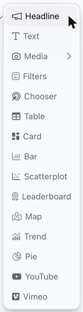
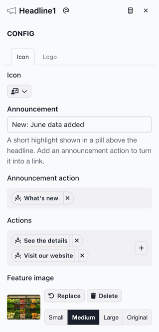
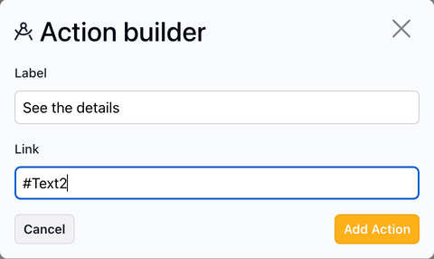
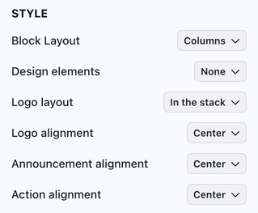

# Headline

The Headline slice combines an icon or logo, an announcement, headline text, action buttons and a feature image to create a header for your report or for a section within it. Here's an example of a configured Headline slice:

<figure><figcaption>
Example Headline slice
</figcaption></figure>

### Adding a headline slice

To add a headline slice, select **Headline** from the chart list.

<figure><figcaption></figcaption></figure>

**Writing the headline text**

You write the headline's title and text directly on the slice. In **Edit** mode, click **Add a title...** on a new headline, or click the text already there, to open the text editor. Its toolbar has a style menu (**Normal**, three heading sizes, **Note**, lists and **Quote**), bold, italic, links and an alignment menu. Click **Close** when you're done.

**Configuring the headline slice**

The CONFIG section has the following fields:

* **Icon** and **Logo**: An icon or a logo image shown with the headline. Pick an icon on the **Icon** tab, or add an image on the **Logo** tab and choose its size. A headline shows an icon or a logo, not both: choosing one replaces the other.
* **Announcement**: Short text shown in a pill above the headline text, such as "New: June data added".
* **Announcement action**: A link shown inside the announcement pill, followed by an arrow.
* **Actions**: Links shown as buttons below the headline text. You can add several.
* **Feature image**: A larger image shown with the headline text. **Block Layout** in the STYLE section sets where it goes.

To add a logo or feature image, click **Add Media**. Choose **Upload image** to add a .jpg or .png file (or drag the file onto the dashed upload area), or **Find images** to search Unsplash for a photo. Then choose a size: **Small**, **Medium**, **Large**, or **Original** to show the image at its own size.

<figure><figcaption></figcaption></figure>

**Adding an action**

Use the **Announcement action** for a single "what's new" link, and **Actions** for the main buttons people use to move around the report.

**Announcement action** and **Actions** both open the Action builder:

1. Click **Add Action** under the field. To add another button to **Actions**, click **+** next to the existing ones.
2. In **Label**, type the link text. If you leave it empty on the announcement action, the link reads "Read more".
3. In **Link**, enter one of these:
   * A full web address, including `https://`, such as `https://www.juiceanalytics.com`. Without `https://`, the link won't open the website.
   * `#` followed by a slice's slug, such as `#Text2`, to link to that slice. The slug is shown at the top of the slice's Editing Panel (see [Slices](https://docs.myjuicebox.io/building-reports/story-designer/slices)).
4. Click **Add Action** in the Action builder to save it.

To change an action, click it in the **Announcement action** or **Actions** field. To remove it, click the **✕** next to it.

<figure><figcaption></figcaption></figure>

**Style options**

The STYLE section includes several options for customizing the headline's appearance. Key Headline-specific options:

* **Block Layout**: Where the feature image goes. **Stacked** (default) puts it below the headline text and **Stacked Reverse** puts it above. **Columns** puts the text on the left and the image on the right, and **Columns Reverse** swaps them.
* **Design elements**: **Blobs** adds soft, blurred shapes behind the headline, in the same color as the action buttons. **None** (default) leaves the background plain.
* **Logo layout**: Where the icon or logo goes. **In the stack** (default) puts it at the top, above the announcement. **Own column left** and **Own column right** put it in its own column beside the announcement, text and buttons.
* **Logo alignment**, **Announcement alignment** and **Action alignment**: Align the icon or logo, the announcement pill and the action buttons **Left**, **Center** (default) or **Right**. To align the headline text, use the alignment menu in the text editor.

<figure><figcaption></figcaption></figure>

### Using a headline slice

**Following links**

Click the announcement link or an action button to follow it:

* A link to a slug (such as `#Text2`) scrolls the report to that slice.
* A link to a web address opens that page in the same browser tab.

**On narrow screens**

On phones and other narrow screens, the **Columns** and **Columns Reverse** layouts show the image below the headline text.

**Using the keyboard**

* Press **Tab** to move to the announcement link or an action button.
* Press **Enter** to follow the link.
