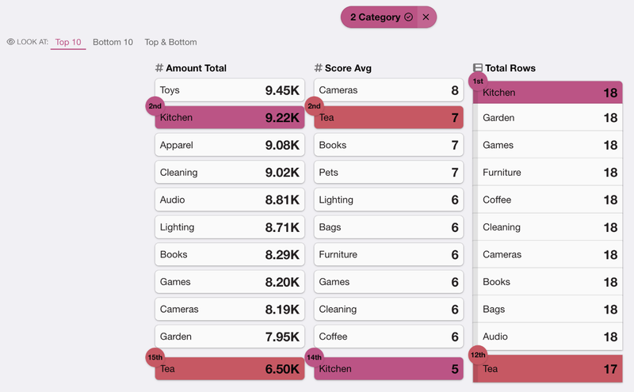
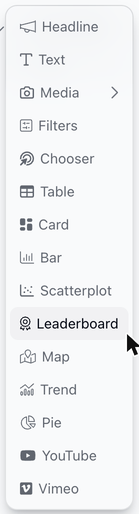
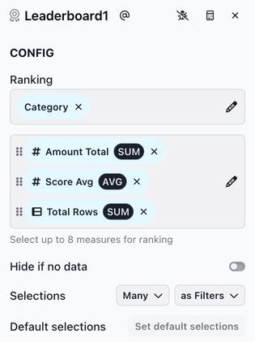
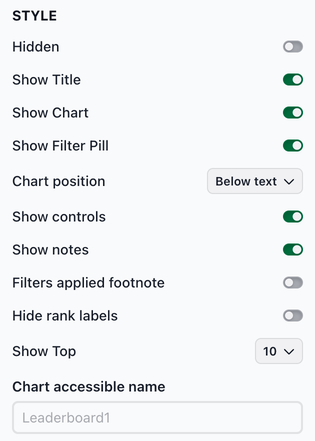

# Leaderboard

The leaderboard chart ranks dimension values by several measures at once, with a ranked column for each measure. Adding a slice with a leaderboard chart (i.e., a leaderboard slice) is a good choice when users want to quickly see the "winners" and "losers," and how each one ranks across different measures.

<figure><figcaption></figcaption></figure>

### Adding a leaderboard slice

To add a leaderboard slice, select **Leaderboard** from the chart list.

<figure><figcaption></figcaption></figure>

**Configuring the leaderboard slice**

The CONFIG section has the following fields:

* **Ranking**: Select the dimension whose values are ranked (e.g., Store, Category, Sales Rep).
* The measures box below **Ranking**: Select up to 8 measures to rank by. Each measure becomes its own column, in the order the measures are listed.
* **Hide if no data**: Toggle to hide the slice when no data is available.
* **Selections**: Controls how many selections a user can make and how those selections affect downstream slices.

<figure><figcaption></figcaption></figure>


Each column ranks values from highest to lowest. To rank a measure from lowest to highest, for example wait times or costs, turn on **Reverse** for that measure in the [measure ingredient editor](../../ingredients/the-ingredient-editor/the-measure-ingredient-editor.md). Reverse is a setting on the measure, so it applies in every slice that uses the measure.


**Style options**

The STYLE section includes several options for customizing the chart appearance. Key Leaderboard-specific options:

* **Show controls**: Shows the links that switch between the top and bottom of the rankings (see **Switching between top and bottom** below). It's on by default.
* **Hide rank labels**: Hides the rank (such as "2nd") shown on selected items.
* **Show Top**: How many rows each column shows: **5**, **10** (the default), **25** or **Custom**. With **Custom**, enter a number from 1 to 250 in **Show custom amount**.
* **Chart accessible name**: A short description of what the chart shows, such as "Sales rankings by store." Screen readers announce it, so people who can't see the chart know what it's about. If you leave it empty, they announce the slice slug (such as Leaderboard1) instead.

<figure><figcaption></figcaption></figure>

### Using a leaderboard slice

Each column ranks the items by one measure. Items with the same value share a rank and are grouped by a gray bar on their left. An item with no value for a measure is listed at the bottom of that column, with **No Data** as its value. Long names are shortened; hover over a name to see it in full.

Hover over an item to highlight it in every column where it's shown.

**Selecting items**

Click an item to select it. If the slice allows more than one selection, click more items to add them. Each selected item gets its own color and is highlighted in every column, with its rank in that column (for example, "2nd"). If a selected item isn't among the rows a column shows, it's added at the end of that column, so you can compare its rank across all measures. Selecting items filters downstream slices.

The filter pill above the leaderboard shows how many items are ranked, or what's selected. Click a selected item again to unselect it, or click the **×** on the filter pill to clear the selection. To find an item that isn't shown, click the filter pill, search for the item, select it and click **Apply**.

**Switching between top and bottom**

When there are more items than the **Show Top** number, links after **LOOK AT:** switch between the top of the rankings, the bottom, or both. For example, with **Show Top** set to 10, **Top 10** shows the top 10 items in each column, **Bottom 10** shows the bottom 10, and **Top & Bottom** shows the top 5 and the bottom 5. With an odd number, the top gets the extra item (for 25: top 13, bottom 12).
