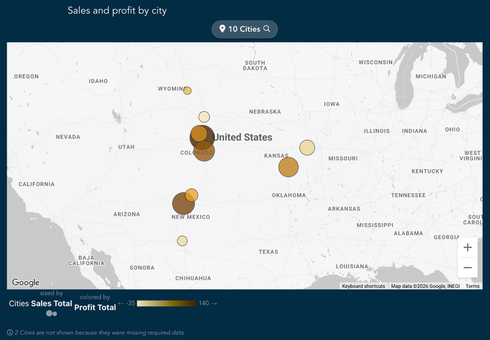
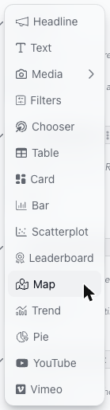
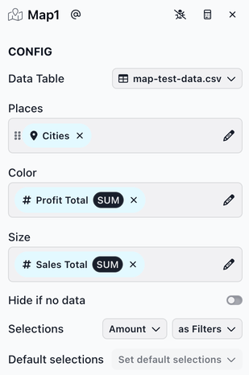
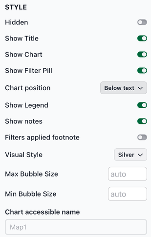
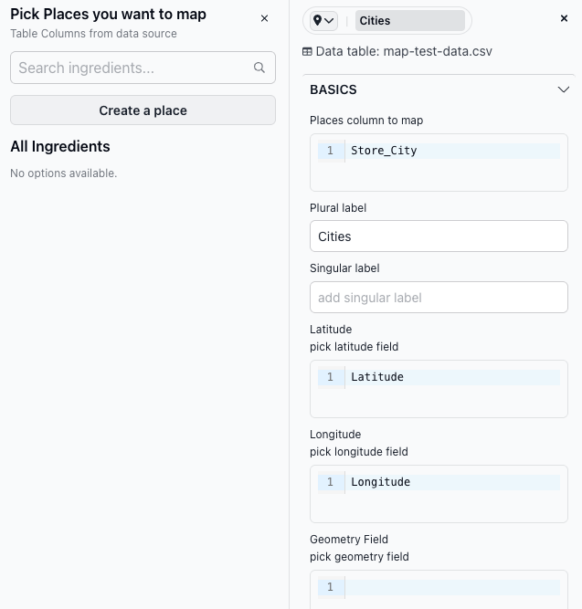

# Map

The map chart shows locations on a map, either as bubbles at a latitude and longitude or as shapes such as states or sales territories. Bubbles can be sized by a measure, and bubbles and shapes can be colored by a measure. Adding a slice with a map chart (i.e., a map slice) is a good choice when users want to see geographic information.

<figure><figcaption></figcaption></figure>

A map shows one or more _places_. A place is a dimension that has a location for each of its values: latitude and longitude columns for bubbles, or a GeoJSON geometry column for shapes. Juicebox doesn't look up locations from names, so your data needs these columns. See the Creating a place section below.

### Adding a map slice

To add a map slice, select **Map** from the chart list.

<figure><figcaption></figcaption></figure>

**Configuring the map slice**

The CONFIG section has the following fields:

* **Places**: Select one or more places to show on the map (e.g., Cities, Sales Territories). To create a place, click the pencil icon next to **Places**, then **Create a place**.
* **Color** (optional): Select a measure that colors each bubble or shape, from light (lowest value) to dark (highest value). When **Places** has more than one place, only the first place's bubbles or shapes are colored by this measure. Each other place is drawn in a single color of its own.
* **Size** (optional): Select a measure that sets the size of each bubble. Larger values get larger bubbles. Size applies to bubbles only.
* **Hide if no data**: Toggle to hide the slice when no data is available.
* **Selections**: Controls how many selections a user can make and how those selections affect downstream slices. When **Places** has more than one place, **Amount** is set for each place.

<figure><figcaption></figcaption></figure>

**Style options**

The STYLE section includes several options for customizing the chart appearance. Key Map-specific options:

* **Show Legend**: Shows or hides the legend below the map. The legend names the place (e.g., Cities) and the measures used for size and color, and shows the color scale with its lowest and highest values. It's on by default.
* **Visual Style**: The look of the base map: **Standard** (default), **Silver**, **Retro**, **Night** or **Cool**.
* **Max Bubble Size** and **Min Bubble Size**: The radius, in pixels, of the largest and smallest bubbles when a **Size** measure is selected. Leave them empty to use the defaults, 25 and 4.
* **Chart accessible name**: A short description of what the chart shows, such as "Sales by city." Screen readers announce it, so people who can't see the chart know what it's about. If you leave it empty, they announce the slice slug (such as Map1) instead, which means little to a viewer.

<figure><figcaption></figcaption></figure>

### Using a map slice

When the map loads, it zooms to fit all its bubbles and shapes.

**Hover tooltips**

Hovering over a bubble or shape shows its name and its values for the **Color** and **Size** measures.

**Selecting bubbles and shapes**

Click a bubble or shape to select it. If the slice allows more than one selection, click others to add them. Click a selected one again to unselect it. Selected bubbles and shapes have a white outline. Selections filter downstream slices.

Each place has its own filter pill. With one value selected, the pill shows its name (e.g., "City: Topeka"); with more, it shows a count (e.g., "2 Cities"). Click the pill to choose values from a list, then click **Apply**. Click the ✕ on the pill to clear the selection.

**Moving around the map**

* Click **+** and **−** to zoom in and out. Scrolling over the map scrolls the page.
* Drag the map to move it.

**Using the keyboard**

Bubbles and shapes are selected with the mouse. With the keyboard, use the filter pill instead:

* Press **Tab** to move to the filter pill, then press **Enter** to open its list.
* Press **Tab** to move into the list, and press **Space** to check a value.
* Press **Tab** to move to **Apply**, then press **Enter**.

**Missing locations**

Values without a latitude and longitude (or without a geometry, for shapes) aren't drawn. A note below the map says how many, for example "2 Cities are not shown because they were missing required data."

### Creating a place

To create a place:

1. In the CONFIG section, click the pencil icon next to **Places**, then click **Create a place**. The place editor opens.
2. At the top of the editor, type a name for the place (e.g., Cities). It's also used as the **Plural label**.
3. Fill in the fields:
   * **Places column to map**: The column with the location names (e.g., city, store or country).
   * **Plural label** and **Singular label**: Used in the filter pill and the legend, for example "2 Cities" or "City: Topeka".
   * For bubbles, **Latitude** and **Longitude**: The columns with each location's latitude and longitude.
   * For shapes, **Geometry Field**: The column with each location's GeoJSON geometry.
4. Click **Save**.
5. In the **Pick Places you want to map** list, click the new place to add it to the map.

<figure><figcaption></figcaption></figure>


Latitude and longitude must be numbers, not text. For example, use `38.8977` rather than `38.8977° N`, and `-77.0365` rather than `77.0365° W`.

GeoJSON is a standard text format for describing shapes on a map. A geometry column holds one GeoJSON geometry per row, for example `{"type": "Polygon", "coordinates": [[[-109.05, 37], [-102.05, 37], [-102.05, 41], [-109.05, 41], [-109.05, 37]]]}`. GeoJSON lists longitude before latitude.

