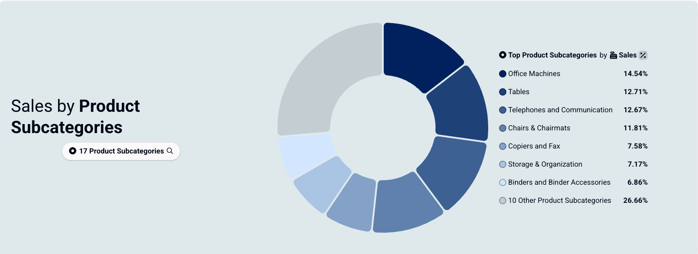
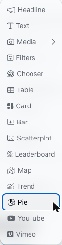
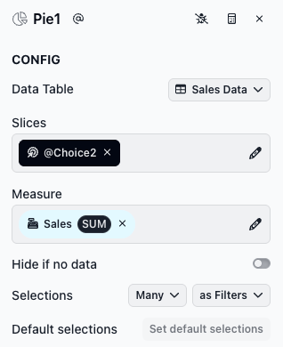
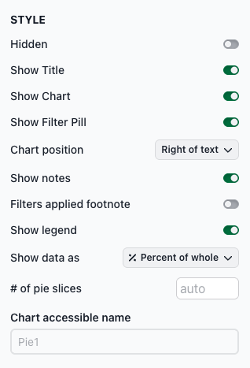

# Pie

The pie chart displays column values and their share of the whole. Adding a slice with a pie chart (i.e., a pie slice) is a good choice when users want to see parts of a whole.

<figure><figcaption></figcaption></figure>

### Adding a pie slice

To add a pie slice, select **Pie** from the chart list.

<figure><figcaption></figcaption></figure>

**Configuring the pie slice**

The CONFIG section has the following fields:

* **Slices**: Select the dimension whose values become the pie slices (e.g., Customer Segment, Region).
* **Measure**: Select the measure that sets the size of each slice.
* **Hide if no data**: Toggle to hide the slice when no data is available.
* **Selections**: Controls how many selections a user can make and how those selections affect downstream slices.

<figure><figcaption></figcaption></figure>

**Style options**

The STYLE section includes several options for customizing the chart appearance. Key Pie-specific options:

* **Show legend**: Shows or hides the legend next to the pie. It's on by default.
* **Show data as**: **% Percent of whole** (default) shows each slice's share of the pie. **# Value** shows each slice's actual value.
* **# of pie slices**: The most slices the pie shows, from 1 to 20. The default is 7. If the dimension has more values than this, the largest values get their own slices and the rest are grouped into one "Other" slice, labeled with how many values it holds (for example, "5 Other Regions"). If it has this many values or fewer, there's no "Other" slice.
* **Chart accessible name**: A short description of what the chart shows, such as "Revenue by region." Screen readers announce it, so people who can't see the chart know what it's about. If you leave it empty, they announce the slice slug (such as Pie1) instead, which means little to a viewer.

<figure><figcaption></figcaption></figure>

### Using a pie slice

Hover over or select a pie slice to see more detail in the center of the chart. Selecting pie slices filters downstream slices.

**Using the keyboard**

* Press **Tab** to move focus to the pie.
* Use the **arrow keys** to move from one slice to the next. Focusing a slice previews it the same way hovering does: the center shows its details, and its legend row is highlighted.
* Press **Enter** or **Space** to select the focused slice. Press either key again to unselect it.
