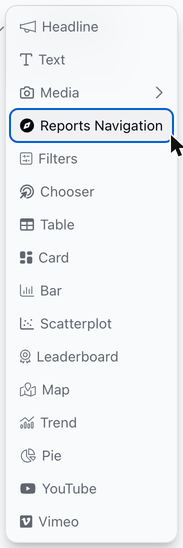
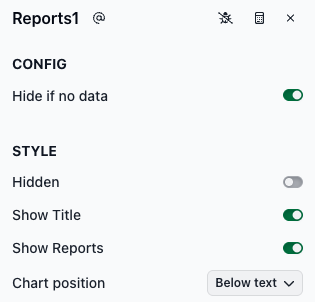

# Reports Navigation


This feature is not available on all plans.


The Reports Navigation slice shows other reports as cards, like the cards on the Reports page. Viewers click a card to open that report in a new browser tab. Here's an example of a Reports Navigation slice.

<figure><figcaption><p>Example Reports Navigation slice</p></figcaption></figure>

### Adding a Reports Navigation slice

To add a Reports Navigation slice, select **Reports Navigation** from the chart list.

<figure><figcaption></figcaption></figure>

### Which reports are listed

The slice lists the reports that the viewer has access to, except:

* reports that haven't been published yet
* the report that contains the slice

Because the list depends on each viewer's access, different viewers can see different cards.

To choose which reports are listed and in what order, add `includeAppSlugs` to the slice's [Advanced configuration](https://docs.myjuicebox.io/building-reports/story-designer/slices/advanced-configuration), with a list of report slugs. A report slug is the part of the report's web address after `/a/`. For example, for `https://yourworkspace.myjuicebox.io/a/sales_overview/`, the report slug is `sales_overview`. (Configuration options call reports "apps", which is why the option is named `includeAppSlugs`.)

```yaml
includeAppSlugs:
  - sales_overview
  - regional_detail
```

Reports in this list still appear only if they're published and the viewer has access to them. The report that contains the slice is never listed, even if its slug is in the list.

### Configuring the Reports Navigation slice

The CONFIG section has one field:

* **Hide if no data**: Toggle to hide the slice when there are no reports to list.

The STYLE section has these options, which work as described on the [Slices](https://docs.myjuicebox.io/building-reports/story-designer/slices) page:

* **Hidden**, **Show Title** and **Chart position**.
* **Show Reports**: Shows or hides the report cards. It's on by default.

<figure><figcaption></figcaption></figure>
