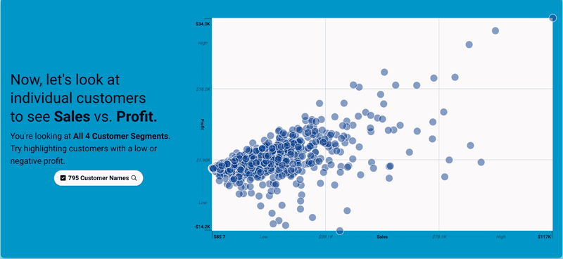
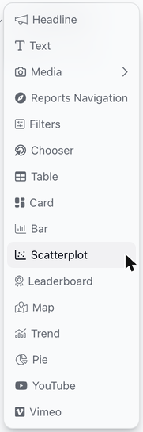
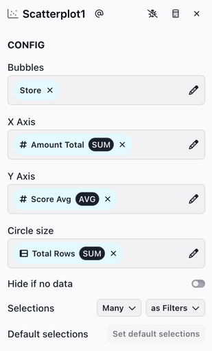
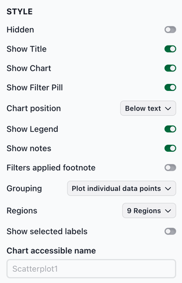

# Scatterplot

The scatterplot chart displays dimension values as bubbles, placed by two measures: one on the x-axis and one on the y-axis. Lines divide the chart into regions, such as low, middle and high, so it's easy to see which values fall into which group. Adding a slice with a scatterplot chart (i.e., a scatterplot slice) is a good choice when users want to see the relationship between two measures.

<figure><figcaption></figcaption></figure>

### Adding a scatterplot slice

To add a scatterplot slice, select **Scatterplot** from the chart list.

<figure><figcaption></figcaption></figure>

**Configuring the scatterplot slice**

The CONFIG section has the following fields:

* **Bubbles**: Select the dimension whose values become the bubbles (e.g., Customer, Store, Product).
* **X Axis**: Select the measure that places each bubble from left (low) to right (high).
* **Y Axis**: Select the measure that places each bubble from bottom (low) to top (high).
* **Circle size** (optional): Select a measure that sets the size of each bubble. Larger values get larger bubbles, and a legend above the chart names the measure. Leave it empty to draw all bubbles the same size.
* **Hide if no data**: Toggle to hide the slice when no data is available.
* **Selections**: Controls how many selections a user can make and how those selections affect downstream slices.

<figure><figcaption></figcaption></figure>

**Style options**

The STYLE section includes several options for customizing the chart appearance. Key Scatterplot-specific options:

* **Grouping**: **Plot individual data points** (default) draws a bubble for each value. **Group similar values** combines nearby values into hexagons; the more values a hexagon holds, the darker it is. Use it when there are so many bubbles that they overlap. With this option, the **Circle size** field and **Show selected labels** are hidden.
* **Regions**: **9 Regions** (default) divides the chart into a 3×3 grid. **4 Regions** divides it into four quadrants. The lines split each axis evenly between the lowest and highest values shown on that axis.
* **Show selected labels**: Shows the name of each selected bubble on the chart. It's off by default.
* **Chart accessible name**: A short description of what the chart shows, such as "Sales vs. profit by customer." Screen readers announce it, so people who can't see the chart know what it's about. If you leave it empty, they announce the slice slug (such as Scatterplot1) instead, which means little to a viewer.

<figure><figcaption></figcaption></figure>

### Using a scatterplot slice

**Hover tooltips**

Hovering over a bubble shows its name and its **X Axis**, **Y Axis** and **Circle size** values. If several values have identical X Axis, Y Axis and Circle size values, they're drawn as one bubble, and its tooltip shows one name followed by "+ N more" for the others.

When **Grouping** is **Group similar values**, hovering over a hexagon shows how many values it holds and the lowest and highest X Axis and Y Axis values among them.

**Selecting bubbles**

Selections filter downstream slices. Selected bubbles are drawn darker. There are several ways to select:

* **Select a bubble**: Click a bubble to select it. Click more bubbles to add them, and click a selected bubble to unselect it. Clicking a bubble that stands for several values selects all of them.
* **Select a region**: Click an empty spot in a region to add all its bubbles to the selection. Click an empty spot in the same region again to remove them. When every bubble in a region is selected, the region is outlined.
* **Select an area**: Click an empty spot and drag to draw a box. The bubbles inside the box replace the current selection.
* **Select a hexagon**: When **Grouping** is **Group similar values**, click a hexagon to select all the values it holds.

The filter pill shows the selection: the value's name when one is selected (e.g., "Customer Name: Roy Skaria") or a count when more are (e.g., "2 Customer Names"). Click the pill to choose values from a list with a search field, then click **Apply**. Click the ✕ on the pill to clear the selection.

**Using the keyboard**

To select with the keyboard, use the filter pill:

* Press **Tab** to move to the filter pill, then press **Enter** to open its list.
* Press **Tab** to move into the list, and press **Space** to check a value.
* Press **Tab** to move to **Apply**, then press **Enter**.

**Large data and missing values**

* With 5,000 or more values in **Bubbles**, the slice shows "There's a bit too much data" instead of the chart, whichever **Grouping** option is used. Add filters so fewer values are shown.
* A value is left out if its X Axis or Y Axis measure is blank. A note below the chart says how many were left out, for example "2 Stores are not shown because they were missing data."
